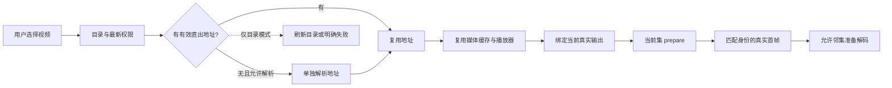

# 短视频秒开播放设计包 · AI 可读

把接口、数据与缓存、Android 播放器和首帧验收放到一条链路中，帮助开发者和 AI 把经过实践的设计迁移到自己的项目。

这是从真实 Android 短剧项目整理的技术文档与接入指南，包含可机读的设计索引和脱敏样本。**当前版本不包含可运行 App、播放器 SDK 或生产数据库迁移脚本。**

## 直接交给你的 AI

把本仓库下载后，连同你自己的项目一起提供给 AI，复制这段话：

> 请先阅读这份设计包的 AGENTS.md、AI_START_HERE.md 和 manifest.json，再检查我的项目。先画出现有的“点击到真实首帧”链路，列出可复用设计、现有缺口和最小实施顺序，再按我授权的范围实施和验证。不要默认创建五个播放器，不要把示意接口当成我的真实接口，不要把历史测速当成我的项目已达标。缺少后端代码或设备时，请继续完成能做的部分，并分别报告实现、构建、联调和实机验收状态。

如果 AI 只能访问一个描述，把 [单文件上下文](AI_CONTEXT.md) 的全文连同你的需求发给它。只有仓库名、简介或网址，而 AI 无法读取仓库内容时，无法保证它理解完整设计。

## 阅读顺序

| 入口 | 内容 |
|---|---|
| [AI_START_HERE.md](AI_START_HERE.md) | AI 如何检查目标项目、选择方案、实施和验收 |
| [整体链路](docs/01-architecture.md) | 秒开在优化什么，各层如何配合 |
| [接口设计](docs/02-api.md) | 目录直出地址、当前集、权限及缺失地址策略 |
| [数据库与缓存](docs/03-data-and-cache.md) | 已知数据对象、Redis、URL 缓存、媒体缓存、进度持久化 |
| [播放器设计](docs/04-player.md) | 全局资源、首帧优先、预热晋升、输出归属、线程与生命周期 |
| [迁移与验收](docs/05-adoption.md) | 按现有瓶颈选方案，每步的完成标准 |
| [性能结果](docs/06-measurement.md) | 样本、计时口径、收益和局限 |
| [来源与版本](docs/07-evidence.md) | 代码核对、后端文档记录及建议的证据等级 |
| [manifest.json](manifest.json) | 供工具和 AI 路由的设计索引 |

## 核心设计

目录带地址减少一段串行请求，缓存减少重复工作，播放器复用保留昂贵状态，当前集优先减少资源争抢。预热到目标真实输出后，才能在切集时直接晋升已有首帧。

## 实测边界

2026-10-21 的同设备实验中，五槽独立线程版本从 0 秒起播的五次中位数为 **593ms**，精确 8 秒续播中位数为 **1083ms**，最慢样本为 **2778ms**。这套设计没有证明所有网络和位置都能稳定一秒内起播。[完整样本与条件](docs/06-measurement.md)

“秒开”是优化目标。隐藏转圈、显示封面、STATE_READY 和下载过分片，都不等于真实视频已经显示。

## 复用范围

技术栈实例为 Kotlin、Jetpack Compose、Media3、DataStore、OkHttp 和 Redis。接入方应优先适配已有架构；iOS、Web 和 React Native 可以复用分层与验收原则，播放器和输出层需要各平台独立实现。

本包省略业务域名、鉴权、真实媒体地址、设备序列号、品牌资源和私有后端代码。JSON 示例使用虚构数据与 example.com 地址，不能直接播放。当前尚未指定开放许可证；公开阅读不等于授予额外的复制、修改或再分发许可。
