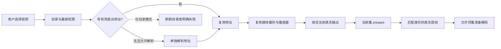

# 短视频秒开播放设计包 · AI 可读

从 **App 端、后端、视频来源** 三层整理高清短视频秒开的实现：最短取址路径、启动预建五路独立播放资源、当前首帧优先与邻集预热，以及 MP4 faststart、云点播转码和 CDN 分发。

这是从真实 Android 短剧项目整理的技术文档与接入指南，包含可机读的设计索引和脱敏样本。**当前版本不包含可运行 App、播放器 SDK 或生产数据库迁移脚本。**

## 直接交给你的 AI

把本仓库下载后，连同你自己的项目一起提供给 AI，复制这段话：

> 请先阅读这份设计包的 AGENTS.md、AI_START_HERE.md 和 manifest.json，再检查我的项目。先画出现有的“点击到真实首帧”链路，列出可复用设计、现有缺口和最小实施顺序，再按我授权的范围实施和验证。不要默认创建五个播放器，不要把示意接口当成我的真实接口，不要把历史测速当成我的项目已达标。缺少后端代码或设备时，请继续完成能做的部分，并分别报告实现、构建、联调和实机验收状态。

如果 AI 只能访问一个描述，把 [单文件上下文](AI_CONTEXT.md) 的全文连同你的需求发给它。只有仓库名、简介或网址，而 AI 无法读取仓库内容时，无法保证它理解完整设计。

## 阅读顺序

| 入口 | 内容 |
|---|---|
| [AI_START_HERE.md](AI_START_HERE.md) | AI 如何检查目标项目、选择方案、实施和验收 |
| [三层技术总览](docs/00-system-design.md) | App 端 / 后端 / 视频来源，各自做什么、如何协作 |
| [整体链路](docs/01-architecture.md) | 秒开在优化什么，各层如何配合 |
| [接口设计](docs/02-api.md) | 目录直出地址、当前集、权限及缺失地址策略 |
| [数据库与缓存](docs/03-data-and-cache.md) | 已知数据对象、Redis、URL 缓存、媒体缓存、进度持久化 |
| [播放器设计](docs/04-player.md) | 全局资源、首帧优先、预热晋升、输出归属、线程与生命周期 |
| [视频来源与分发](docs/08-media-source.md) | MP4 faststart、高清编码、阿里云/火山点播与 CDN |
| [迁移与验收](docs/05-adoption.md) | 按现有瓶颈选方案，每步的完成标准 |
| [性能结果](docs/06-measurement.md) | 样本、计时口径、收益和局限 |
| [两台手机对照](docs/09-device-comparison.md) | nova 7 SE与Mate 40 Pro配置、同包同视频的真实首帧 |
| [来源与版本](docs/07-evidence.md) | 代码核对、后端文档记录及建议的证据等级 |
| [manifest.json](manifest.json) | 供工具和 AI 路由的设计索引 |

## 核心设计

1. **后端：少一次等待。** 目录直接带最新权限和有限播放地址窗口，缓存有效结果，批量读短 URL，避免客户端与后端内部的重复串行取址。
2. **App 端：提前准备、保持复用。** 启动预建五个播放器，各槽独立播放队列、缓冲控制和预加载器；共用磁盘缓存，当前集先出帧，邻集准备后直接晋升。
3. **视频来源：更早拿到可解码数据。** 普通 MP4 做 faststart；结合高清转码、合适码率/GOP 和 CDN 加速，在画质与起播速度之间取得平衡。

目录带地址减少一段串行请求，缓存减少重复工作，播放器复用保留昂贵状态，当前集优先减少资源争抢。预热到目标真实输出后，才能在切集时直接晋升已有首帧。

## 当前实测（2026-10-22）

当前工作区构建的 Performance 包，实际播放 **1080×1920 MP4 / H.264 / 25fps，视频码率约 1.55Mbps**。同一目录当前集各测 5 次，每轮重启进程并清当前媒体缓存：

| 场景 | 点击到真实首帧中位数 | 5 次范围 |
|---|---:|---:|
| 从头起播 | **666ms** | 636–706ms |
| 精确 8 秒续播 | **1004ms** | 980–1066ms |

这组高清从头起播样本均在一秒内；精确续播约一秒。10 次均通过一次目录请求拿到当前来源，没有在当前来源就绪前再调用独立取址接口。它说明三层协同的当前效果，不把本次不同章节的数据与早期迭代当作严格性能 A/B。[完整样本与条件](docs/06-measurement.md)

另验证了全局5实例、5个独立播放线程与8次双向手势的媒体身份复用，其中目录当前第3、4集的高清邻帧为1080×1920。其他回退来源有较低分辨率，按实际来源分别记录，未将全部测试素材统称超清。

随后在 **Mate 40 Pro / 麒麟9000 / 8GB** 上，用同一个包与同一集复测：从头起播中位数 **552ms**（455–1355ms），精确8秒续播中位数 **881ms**（821–1001ms），仍为1080×1920。完整样本、设备配置及跨设备比较边界见 [设备对照](docs/09-device-comparison.md)。

“秒开”是优化目标。隐藏转圈、显示封面、STATE_READY 和下载过分片，都不等于真实视频已经显示。

## 复用范围

技术栈实例为 Kotlin、Jetpack Compose、Media3、DataStore、OkHttp 和 Redis。接入方应优先适配已有架构；iOS、Web 和 React Native 可以复用分层与验收原则，播放器和输出层需要各平台独立实现。

本包省略业务域名、鉴权、真实媒体地址、设备序列号、品牌资源和私有后端代码。JSON 示例使用虚构数据与 example.com 地址，不能直接播放。

## 许可证

本仓库原创文档、提示词、示例与索引采用 [MIT 许可证](LICENSE)。复用时保留版权和许可声明；外链资料适用各自的许可。
