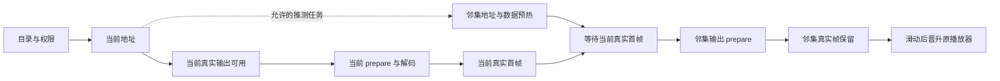

# 整体链路：先减少等待，再让准备结果真正复用

## 三种“快”要分开

| 场景 | 起点 | 主要待解决问题 |
|---|---|---|
| 首次进入 | 点击回调 | 目录、地址、媒体网络、输出和解码串行等待 |
| 相邻切集 | 播放目标切换；另可测手势到显示 | 已准备邻集是否保持原媒体和输出身份 |
| 非零位置续播 | 点击/恢复事件 | 进度加载、seek、关键帧依赖与前滚解码 |

首帧终点统一为目标媒体真实渲染回调。页面出现、播放器 READY、解码器创建完成都是中间节点。

## 原串行路径与直出路径

原路径：点击 → 目录 → 当前视频 ID → 地址解析 → 媒体请求 → 解码。

目录带有效地址后：点击 → 目录与地址 → 媒体请求 → 解码。优化的前提是后端能够低成本组装窗口；若每次目录都串行调用多次 VOD，可能只是把等待挪到服务端。

允许请求和数据准备提前，不表示所有播放器都应同时抢解码。当前集首帧是冷进入时释放邻集 prepare 的条件。

## 每层解决的具体问题

| 层 | 设计 | 不能替代什么 |
|---|---|---|
| 接口 | 聚合目录、权限、有限地址窗口 | 媒体下载与解码 |
| 服务端缓存 | 复用 VOD 结果、批量读取短 URL | 最新权限验证、签名有效期 |
| 客户端 URL 缓存 | 命中/合并/晋升/取消 | 已解码首帧 |
| 媒体缓存 | 复用已下载字节 | 输出绑定与 decoder 准备 |
| 播放器与输出复用 | 保持媒体、Surface、首帧身份 | 未准备内容的瞬时显示 |
| 调度 | 当前优先、有界预热、让出带宽 | 更多硬件解码能力 |
| 观测 | 找到实际等待阶段 | 真实优化本身 |

## 技术选型的依据

底层 HLS 与解码交给 Media3，应用实现业务权限、窗口调度和生命周期。Media3 官方提供预加载管理器，可以在用户选择前加载媒体：[官方预加载文档](https://developer.android.com/media/media3/exoplayer/preloading-media/preloadmanager)。

HLS URL 直接交给播放器，不在应用层另写清单解析器。多码率自适应还需要服务端提供相应变体清单；单个媒体清单不自动具备 ABR。[官方 HLS 文档](https://developer.android.com/media/media3/exoplayer/hls)
